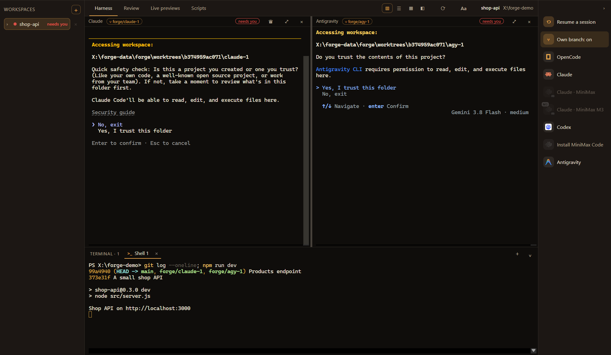
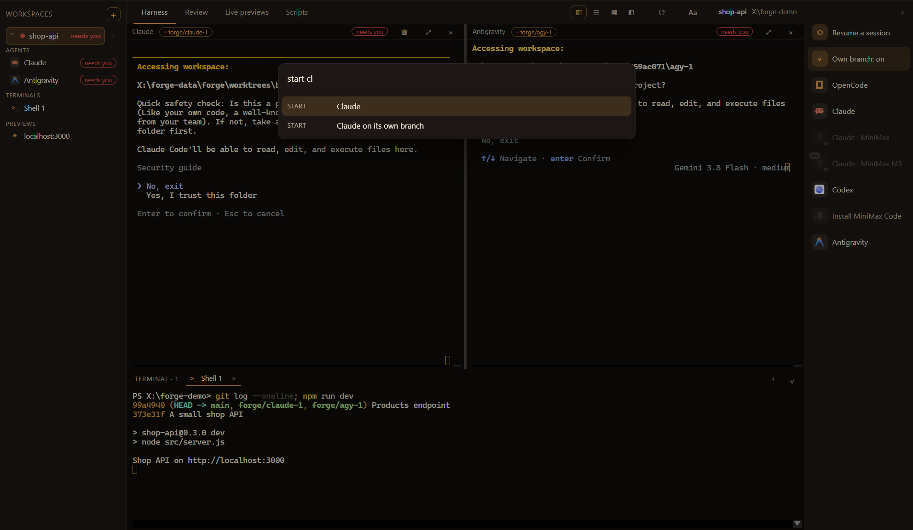

# Forge

A workplace for coding agents. Real terminals for Claude Code, Codex, OpenCode, Antigravity and your own shells, side by side, in the folders you work in. Each agent can work on its own git branch, they keep running when you close the window, and other agents or scripts can drive them from the command line.



## What it does

- **Harness.** Start agents from the side bar and arrange them: side by side, stacked, grid, or one lead on half the screen. Each pane shows what its agent is doing (working, needs you, done), and a desktop notice tells you when one needs you. Resume past sessions, and restore what ran before (nothing starts on its own).
- **Own branch per agent.** Switch on *Own branch* and every new agent gets a git worktree of its own on `forge/<pane>`, so two agents never edit the same files. The pane shows its branch; the side bar lists each branch with its commits ahead and uncommitted files, and removes a finished worktree (the branch and its commits stay for you to merge).
- **Agents that outlive the window.** The engine runs as its own background process. Close Forge and the agents keep working; open it again and they are there, screens and all. With nothing running and no window open for ten minutes, it ends itself.
- **Lead.** One Claude Code pane commands the others (start, message, read, wait, stop) through a local MCP endpoint, and can put each on its own branch. Every call is decided first by the host app's security core; without one, the lead is off.
- **Review.** Your checks first, then read-only auditors (correctness, security, intent, test integrity, AI slop, architecture) and a verifier.
- **Live previews.** The dev servers your scripts start, shown in place.
- **Scripts.** Your commands, started and stopped in a terminal panel.
- **Command bar.** `Ctrl+K` finds anything by a few letters: a pane, a workspace, an agent to start, a layout, a tab.



Shortcuts: `Ctrl+K` command bar, `` Ctrl+` `` terminal panel, `Alt+1`–`4` tabs, `Ctrl+Shift+B` own branches on or off. In a terminal: `Ctrl+F` find, `Ctrl+=` / `Ctrl+-` / `Ctrl+0` text size.

**Look.** The `Aa` menu sets Solid or Glass (on Windows 11 the window gets the system's acrylic), an accent colour, and the terminals' theme, font and size.

## The `forge` command

The same engine, from a terminal or a script. If no engine is running, the command starts one. Whatever it starts shows up in the app.

```bash
forge agents                                   # what can be started
forge start codex --branch --task "Add validation to src/api/users.ts and its tests. Commit when green."
forge wait codex-1 --timeout 600               # until done, idle or it needs someone
forge read codex-1 --lines 80                  # the end of its screen
forge send codex-1 "Also cover the empty-email case."
forge branches                                 # each own branch: commits ahead, uncommitted files
forge stop codex-1
```

`forge help` lists every command; `--json` gives machine-readable output. An agent such as Claude Code can use this to hand work to other agents. The skill in [`skills/forge`](skills/forge/SKILL.md) teaches it how.

## Run it on its own

```
npm install
npm start
```

Its data (workspaces, scripts, reviews, worktrees) lives in `%APPDATA%/Forge` (set `FORGE_DATA_DIR` to use another folder). After a build, the command is `node dist-app/forge.cjs`, or `forge` once linked (`npm link`).

## How it is built

- **Engine and window are separate.** The engine owns the terminals (node-pty, with a headless xterm per pane for its screen), worktrees, reviews and the lead. Pages talk to it only through messages, so the same engine runs inside an app, in a utility process, or detached in the background.
- **Detached and private.** The background engine listens on a local named pipe (a socket file on macOS and Linux). It answers only a caller that presents the token on its card in the data folder, and that file is readable only by its owner.
- **Nothing runs unasked.** Agents start only when you or your lead start them. Showing a pane again never restarts it.
- **CI** type-checks and builds on Windows and Linux for every push and pull request.

## Inside another Electron app

Forge is built into Freya from `packages/forge` (this repository, checked out there).

```ts
// main process: the engine in this process
import { mountForge, shutdownForge } from '@freya/forge/main'
mountForge({ window: () => mainWindow, security, navigate })   // security and navigate are optional
app.on('will-quit', shutdownForge)

// or in a process of its own (restartable), optionally outliving the app
import { mountForgeProcess } from '@freya/forge/main'
const forge = mountForgeProcess({ window: () => mainWindow, workerPath, daemonPath })   // daemonPath: keep agents running after quit
app.on('will-quit', () => { void forge.stop() })

// page
import { ForgeWorkspace, setForgeBridge } from '@freya/forge/ui'
setForgeBridge(window.yourPreloadBridge)   // forge(), onForgeEvent, onForgeState, onForgeTerminal, setWindowGlass?
<ForgeWorkspace />
```

The host's preload must forward the `freya:forge` invoke channel and the `freya:forge:event`, `freya:forge:state` and `freya:forge:term` push channels (see `app/preload.ts`). The host must also give the CSS tokens `--f-bg`, `--f-ink`, `--f-muted`, `--f-line` and `--f-accent` (see `app/theme.css`).
